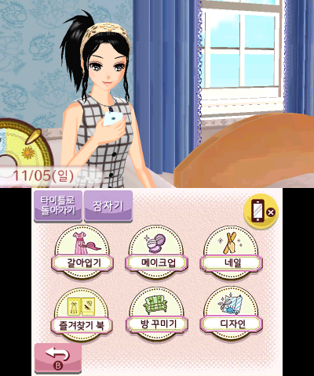
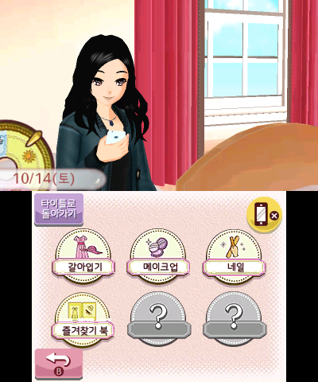
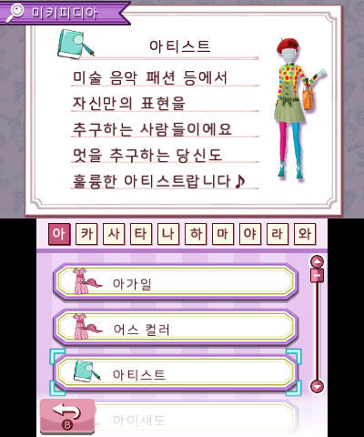
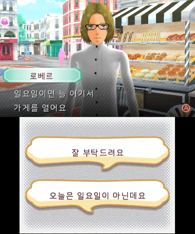

# 걸스 모드 4 한국어 패치 0.5

일본판 **Girls Mode 4 - Star & Stylist**의 한국어 패치입니다.

- 배포 버전: **0.5**
- 한글화: **롱홍**
- 대상 타이틀 ID: `000400000019F600`

## 반영 내용

- 번역 메시지 71,203개를 반영했습니다.
- 나눔스퀘어라운드 기반 한글 글꼴 6개를 반영했습니다.
- 이미지 491개의 한글화·보정을 반영했습니다.

## 스크린샷

<p align="center">
  
  
</p>
<p align="center">
  
  
</p>

## 다운로드

[버전 0.5 릴리스](https://github.com/verylonghong/3ds-kr-patch-girls-mode-4/releases/tag/v0.5)에서 다음 두 가지 패치를 제공합니다.

| 파일 | 용도 | 크기 |
| --- | --- | ---: |
| `GS4_Korean_v0.5_From_Japan_3DS.xdelta` | 지정한 원본 `.3ds`에 적용 | 4,769,398바이트 |
| `GS4_Korean_Repack_v0.5.zip` | RomFS·ExeFS 교체 후 재패킹 | 12,972,252바이트 |

## 기준 원본과 SHA-256

### xdelta 기준 원본

파일명: `Girls Mode 4 - Star & Stylist (Japan).3ds`

파일 크기: **1,073,741,824바이트**

```text
c4e36a941c183633d93d7df40b10b23616dc0092334477c4b1d28264714e3b30
```

xdelta는 원본의 내용이 위 해시와 일치해야 합니다.

PowerShell에서 확인하는 명령:

```powershell
Get-FileHash -Algorithm SHA256 -LiteralPath 'Girls Mode 4 - Star & Stylist (Japan).3ds'
```

## xdelta 적용

xdelta3로 다음과 같이 적용합니다.

```powershell
xdelta3.exe -d -s "Girls Mode 4 - Star & Stylist (Japan).3ds" "GS4_Korean_v0.5_From_Japan_3DS.xdelta" "GS4_Korean_v0.5.3ds"
```

결과 파일은 **3DS 파일**입니다.

- 결과 파일명: `GS4_Korean_v0.5.3ds`
- 결과 크기: **824,578,048바이트**
- 결과 SHA-256:

```text
fa4c698f0a8f69c2da99e993d0352aecb3118746cc7f6f61271d6a6d1a8946e3
```

## 재패킹 ZIP 적용

SHA-256 값이 맞는 원본 롬을 찾기 어려울 경우 재패킹 ZIP을 적용해주세요.
ZIP에는 다음 구조의 교체 파일 **34개만** 들어 있습니다.

```text
000400000019F600/
├─ romfs/          # 번역·글꼴·이미지 교체 파일 33개
└─ exefs/
   └─ icon.bin     # 게임 아이콘 1개
```

1. 재패킹 도구로 일본판 게임 본체의 RomFS와 ExeFS를 추출합니다.
2. `000400000019F600/romfs/`의 내용을 추출한 RomFS에 같은 상대 경로로 덮어씁니다.
3. `000400000019F600/exefs/icon.bin`을 추출한 ExeFS의 아이콘에 덮어씁니다.
4. 재패킹 도구로 ExeFS·RomFS 및 CIA 또는 3DS를 다시 생성합니다.

`exefs/icon.bin`은 **재패킹용**입니다. 공식 Luma3DS의 LayeredFS 폴더에 넣는 것만으로 HOME 메뉴 아이콘이 변경되지는 않습니다.

## 글꼴 라이선스

한글 글꼴은 `NanumSquareRoundR.ttf`를 바탕으로 만든 **GS4 Korean Round** 비트맵 글꼴입니다. [SIL Open Font License 1.1](licenses/NanumSquareRound-OFL.txt)을 따릅니다. 저작권 및 변경 안내는 [FONT-NOTICE.md](FONT-NOTICE.md)에 있습니다.
